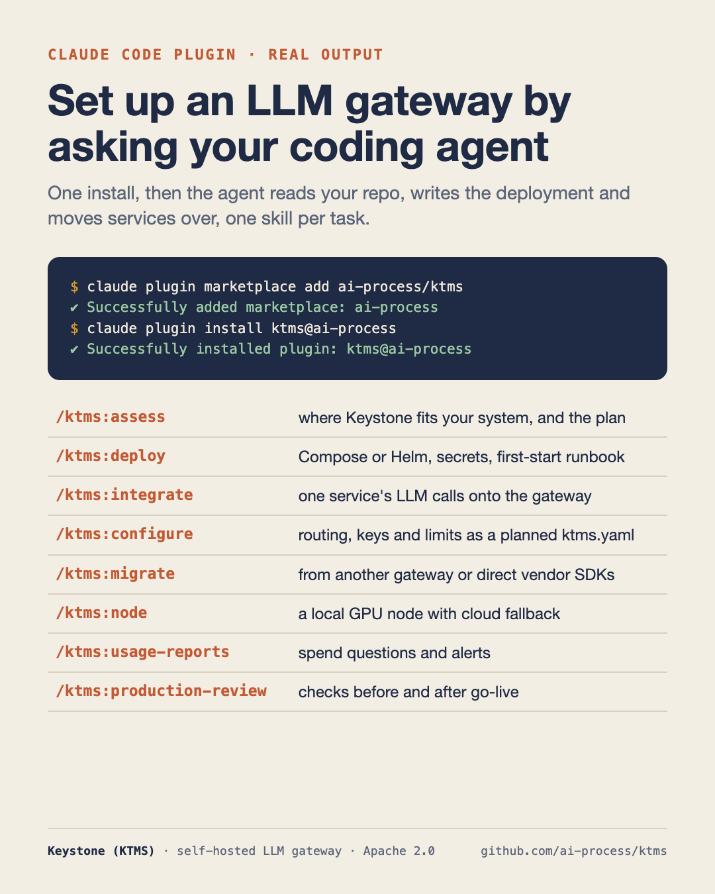
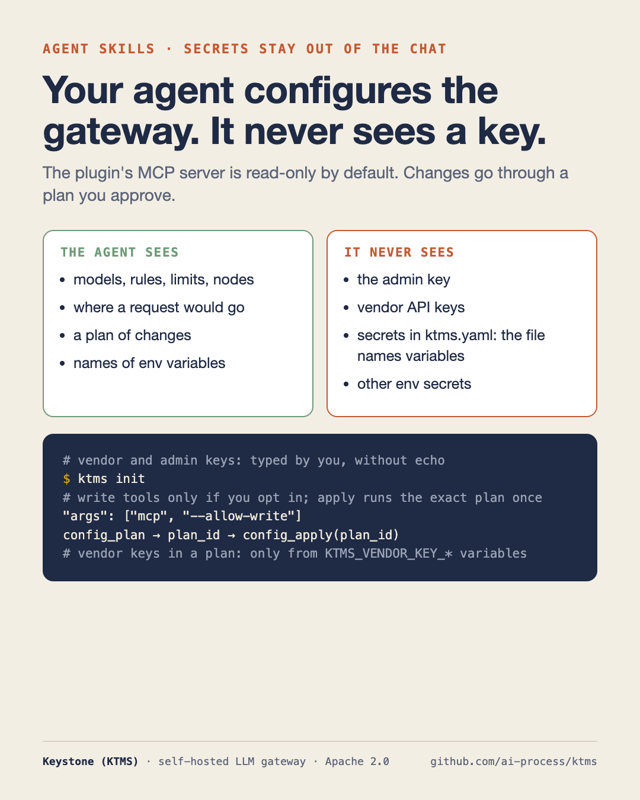

Putting a gateway in front of your LLM calls is not hard, but it touches a lot of places: a
Compose file or a Helm release, secrets, a client module in every service, a model value at every
call site, limits and routing rules. Ask a general-purpose coding agent to do it and it will
happily invent environment variables that don't exist.

So Keystone ships a Claude Code plugin: eight skills that know the real commands, flags and
config fields, and two MCP servers that let the agent read what is running. This post walks
through it on a small demo project.

---

## 1. Install

```bash
claude plugin marketplace add ai-process/ktms && claude plugin install ktms@ai-process
```

```text
✔ Successfully added marketplace: ai-process (declared in user settings)
Installing plugin "ktms@ai-process"...✔ Successfully installed plugin: ktms@ai-process (scope: user)
```

The plugin's version is Keystone's release. The skills call the `ktms` CLI, so put it on `PATH`
from a [release archive](https://github.com/ai-process/ktms/releases) or with
`go install github.com/ai-process/ktms/cmd/ktms@latest`.

| Skill | For |
| --- | --- |
| `/ktms:assess` | Where Keystone fits the system you run in, and the plan to get there |
| `/ktms:deploy` | Compose or Helm for the stack, and the first-start runbook |
| `/ktms:integrate` | Moving a service's LLM calls onto Keystone |
| `/ktms:configure` | Routing, keys and limits as a ktms config file, planned and applied |
| `/ktms:migrate` | Moving from LiteLLM or vendor SDKs |
| `/ktms:node` | A local GPU node with cloud fallback |
| `/ktms:usage-reports` | Spend questions, reports and alerts from light-tokenmeter |
| `/ktms:production-review` | Checking a deployment before and after it goes live |

You don't have to remember the names: the agent picks a skill when the task fits, and the slash
command starts one directly.

---

## 2. Assess: where does the gateway go?

The demo project has three services: a support bot on the OpenAI SDK with `model="gpt-4o"`
hardcoded twice, a search API on the Anthropic SDK plus OpenAI embeddings, and a nightly worker
that calls Gemini about 40,000 times a night. Postgres, Redis and Prometheus are already in the
Compose file.

`/ktms:assess` changes nothing. It reads the code and the deployment, lists every LLM call site
with file and line, and reports where Keystone would run, what each service changes, what it
brings and costs here, and which skill to run next. It also says plainly when Keystone is not
worth it, for example for one service with one model and no limits to keep.

The answer is a report of about a hundred lines. It found all
five call sites with file and line, and a few things nobody asked about:

> Every service loads it through `env_file`, so each one gets all three vendor keys.

> **`temperature=0.3` in `draft_reply`:** `/v1` ignores it, so check reply quality after the switch.

It also noticed that `rerank.ts` doesn't rerank at all, only explains results, and that the
nightly worker is where most of the money and risk is. This is where it puts the gateway:

```text
  Compose project "demo-shop" (one network, nothing exposed to the host)
  ┌─────────────────────────────────────────────────────────────────┐
  │  support-bot ─┐                                                 │
  │  search-api ──┼── HTTP :8080 /v1 ──▶  ktms ──▶ OpenAI           │
  │  digest-worker┘   (gRPC :9090 later        ├─▶ Anthropic        │
  │                    for batch)              └─▶ Gemini           │
  │                                  │  │  │                        │
  │      postgres:16 ◀── db "ktms" ──┘  │  └── :9091 ◀── prometheus │
  │      redis:7 ◀──── limits ──────────┘                           │
  │      light-tokenmeter ◀── usage events (spend per action_id)    │
  │      ktms-admin  (internal only; reach it via SSH tunnel/VPN)   │
  └─────────────────────────────────────────────────────────────────┘
```

The verdict comes with a condition:

> **Verdict:** worth it. If the system were only support-bot on `gpt-4o`, it wouldn't be.

The plan that follows starts with the nightly worker, because it has one call site, isn't
user-facing and a failed night can simply be re-run.

---

## 3. Deploy and configure, with your keys out of the chat

`/ktms:deploy` asks first: Compose on one host or Kubernetes with Helm, managed or in-cluster
Postgres and Redis, where secrets live, hostnames, monitoring. Then it writes the files with every
secret as a reference to your store, probes on `/readyz`, and a first-start runbook.

The runbook has one step the agent leaves to you on purpose: `ktms init` in your own terminal.
It asks for the admin key and the vendor keys without echo, so they never reach the chat, writes
`ktms.yaml` with default models and rules, shows the plan and applies it.



From then on `/ktms:configure` works on that file, like Terraform: edit, `ktms config plan`, show
the plan, apply only after you agree. The guard rails are in the tools, not in the prompt:

- The `ktms` MCP server is **read-only by default**. Write tools exist only if you add
  `--allow-write` to its arguments.
- `config_plan` returns a `plan_id`; `config_apply` applies exactly that plan, once, and refuses
  if Keystone changed in between.
- A vendor key in a plan is read from the MCP server's environment, and only from variables named
  `KTMS_VENDOR_KEY_*`, so the agent cannot point a config at the admin key or another secret.
- Names and values that come back from Keystone are marked as data, not instructions.

---

## 4. Integrate one service

`/ktms:integrate` starts by listing call sites and changing nothing. Then it puts the base URL,
key, timeouts, retries and attribution in one small client module, and replaces each hardcoded
model with an effort, with a one-line reason per call site: low for classification and short
answers, medium for ordinary generation, high for reasoning and long documents.

It also turns off the SDK's own retries and applies Keystone's error contract once (wait out
`Retry-After` on 429, back off on 503, never retry a configuration error), and flags what doesn't
map: embeddings keep an exact model id, and `temperature`, `top_p`, `stop` and `seed` are ignored
on Keystone's OpenAI-compatible API.

The check at the end uses real routing, not a guess:

```text
$ ktms route explain billing --effort low
rule: default   effort: low   route mode: direct
#  MODEL             VENDOR  STATE
1  gpt-4o-mini       openai  kept
2  gemini-2.5-flash  google  dropped: no_vendor_key
3  gpt-4o            openai  dropped: effort
tries: gpt-4o-mini
```

That output is from Keystone 1.3.6: a chain that ends in a kept model is fine; one that ends in
`no_vendor_key` means a key is missing before the service ever goes live.

---

## 5. Why the skills don't drift

A skill that names a flag removed two releases ago sends the agent into an error, and the agent
will then improvise. So Keystone's CI reads every `SKILL.md` and fails when one names a `ktms`
command, a flag, an MCP tool or a README section that doesn't exist in that version.

---

## Other agents

The skills are plain Agent Skills, a folder with a `SKILL.md`: copy `plugin/skills/*` into the
skills directory of Codex, Cursor or another agent that reads them, and add the two MCP servers to
its config. Assistants without skills or MCP can use the same instructions as
[prompts](https://ai-process.dev/docs/prompts/).

* Plugin: [github.com/ai-process/ktms/tree/main/plugin](https://github.com/ai-process/ktms/tree/main/plugin)
* Keystone: [github.com/ai-process/ktms](https://github.com/ai-process/ktms)
* Release notes: [Keystone 1.0](https://blog.ai-process.dev/2026/10/27/keystone-1-0/)
