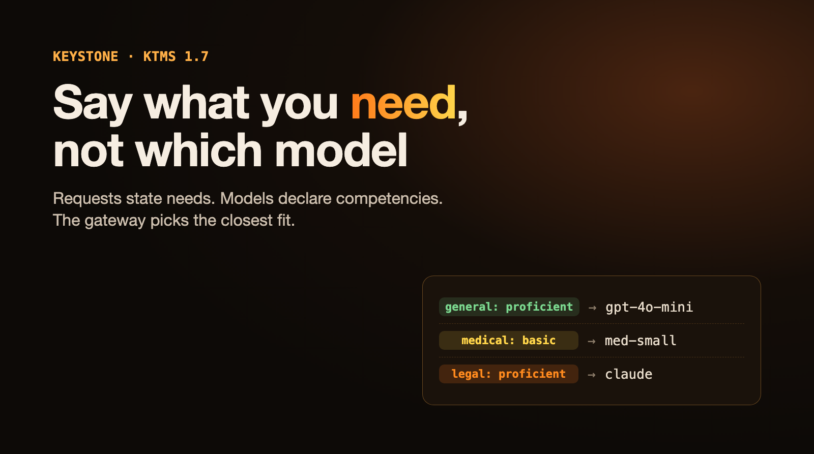

Until 1.7 a request to Keystone. The Model Switchboard. (KTMS) carried one routing field: an
**effort**, `LOW`, `MEDIUM` or `HIGH`. That was enough to keep model names out of application code,
and it had two problems. The word *effort* already means something else: it is how much a thinking
model reasons, and OpenAI's `reasoning_effort` collided with ours in the HTTP adapter. And one axis
is not enough. A medical summary is not "harder" than a legal one; it needs a different model.

KTMS 1.7 replaces effort with two maps.

## Competencies and needs

A model declares its **competencies**, and a request states its **needs**. Both are a topic and a
level:

```yaml
models:
  - {id: gpt-4o-mini,  vendor: openai, competencies: {general: proficient}}
  - {id: med-small,    vendor: local,  competencies: {general: basic, medical: proficient}}
  - {id: claude,       vendor: anthropic, competencies: {general: expert, medical: expert, legal: proficient}}
```

The operator picks the topics; they are plain lowercase words. The levels are ordered,
`basic` < `proficient` < `expert`, and a model meets any need at its own level or below. The code
says what it needs and knows nothing about models:

```python
client.chat.completions.create(
    model="auto:medical=basic",          # or the X-KTMS-Needs header, for SDKs that fix the model value
    messages=[{"role": "user", "content": text}],
)
```

Over gRPC the same request has `needs: {medical: basic}`. An unknown level is `INVALID_ARGUMENT`; an
unknown topic is no error, it just finds no model, and `ktms route explain` says so.

## Routing without a rule

Rules stay, and a matching rule still decides: it matches each of its topics at least at its level,
and its chain is filtered to the models that meet the request. What is new is what happens when no
rule matches. Once any model declares competencies, Keystone picks the chain itself:

1. the enabled models that meet every need and the request's capabilities, have a vendor key, and
   are permitted by the key's and team's `allowed_models`;
2. ordered by placement class first (`nodes_first`, `cloud_first`), so a free local node does not
   take traffic a `cloud_first` caller wanted in the cloud;
3. then by **excess**, the levels above the need summed over the needed topics, so an expert is not
   spent on a basic task;
4. then by the blended price `(3 × price_in + price_out) / 4` per million tokens;
5. and the first three make the chain, the best fit and two fallbacks.

The ranking itself is a few lines in `internal/router/select.go`:

```go
slices.SortStableFunc(cands, func(a, b Candidate) int {
	if ka, kb := a.Dropped == "", b.Dropped == ""; ka != kb {
		if ka {
			return -1
		}
		return 1
	} else if !ka {
		return 0 // dropped ones stay in id order
	}
	return cmp.Or(cmp.Compare(a.Excess, b.Excess), cmp.Compare(a.Price, b.Price))
})
```

Rules become what they should have been: the exceptions. Pin a chain for a tenant, run a canary,
mirror to a shadow model; everything else routes by what the models can do. The order and the price
formula are experimental in 1.7 and may still change in a minor release; which models qualify is
stable.

`ktms route explain KEY --needs medical=basic` shows the whole selection: every model, kept or
dropped with the reason, its excess and price, and `chain_length` for the ones past the third.

## Nothing to change on upgrade

Effort is deprecated, not gone. `LOW`, `MEDIUM` and `HIGH` are now the needs `general: basic`,
`proficient` and `expert`, and every effort field keeps working until 2.0. A model described by
`efforts` keeps serving exactly those efforts, so a 1.6 configuration routes the same after the
upgrade, and keeps needing its catch-all rule per effort until a model declares competencies.

`ktms config plan` prints a `hint:` for each model and rule that still uses efforts, with the
competencies or needs to write instead. Two things to know:

- **Upgrade ktms-admin together with the gateway.** A console from before 1.7 saves models and rules
  without the new fields and would erase them.
- **Metrics and usage keep their shape.** The `effort` label of `ktms_requests_total` is the
  request's general need as `low`, `medium` or `high`; usage events keep `effort` and gain `needs`
  (`general=basic,medical=proficient`).

## Also in 1.7

- The process on a node is now called the **node daemon**: "agent" is left to AI agents and their
  inbox. The `ktms-node` binary, its service, flags and environment variables keep their names.
- Speech, images, judgments and translation take `needs` too; without them only the modality
  filters, as before. Translation selection ranks by the price per million characters.
- `ktms chat --needs`, `needs` in the MCP tool `explain_route`, and competencies and needs columns
  in `ktms models list` and `ktms rules list`. The plugin skills `configure`, `integrate`, `migrate`
  and `node` now speak of needs.
- ktms-admin 1.4: competencies on the model form, needs on rules and in the Playground, and *Where would
  it go?*, the route explanation for a client key.

Docs: [Needs and competencies](https://github.com/ai-process/ktms/blob/main/docs/concepts.md#needs-and-competencies),
[Rules](https://github.com/ai-process/ktms/blob/main/docs/configuration.md#4-rules),
[API stability](https://github.com/ai-process/ktms/blob/main/docs/stability.md).
Code: [`internal/router/select.go`](https://github.com/ai-process/ktms/blob/main/internal/router/select.go),
[`internal/registry/competency.go`](https://github.com/ai-process/ktms/blob/main/internal/registry/competency.go).
