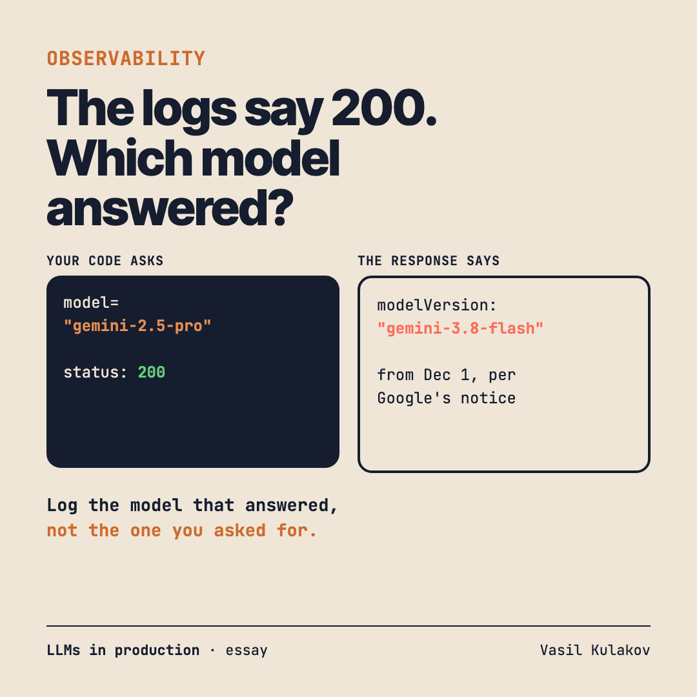

**A user says the answers got worse last week. Your logs say every call returned 200, and your
code says `model="gemini-2.5-pro"`.** So everyone assumes that model answered. It may not have.

The name in your code is what you asked for. Between that request and the answer there can be a
fallback chain, a router, a cache and the vendor's own aliasing. Each of them can change who
answers without changing the status code.

This post shows what Keystone. The Model Switchboard. (KTMS) records about the model that
actually served a call, where you can read it, and where its knowledge stops.

---

## Four ways the answer comes from somewhere else

1. **Fallback.** A rule in Keystone is an ordered chain of models. If the first one is rate
   limited, paused after a `Retry-After`, behind an open circuit breaker or times out, the next one
   answers. The client still gets 200.
2. **Routing.** With `model: "auto"`, a judge picks the effort, and the effort picks the rule
   ([how that works](/2026/10/28/how-model-auto-decides/)). Two identical-looking requests can land
   on different models by design.
3. **Cache.** With the cache on, an answer may be one that was stored earlier, from whichever model
   produced it then.
4. **The vendor.** An alias such as `-latest` is moved to new releases by the vendor. Google has
   also announced that from December 1, Gemini API requests for `gemini-2.5-pro` go to
   `gemini-3.8-flash`. Same code, same name, different model.

The first three happen inside the gateway, so the gateway can tell you about them. The fourth
happens behind the vendor's API, and that matters later in this post.

## What the response tells you

On the OpenAI-compatible endpoint, the `model` field of a chat completion is not an echo of your
request. KTMS fills it with the registry model that served the call
([`internal/server/openai.go`](https://github.com/ai-process/ktms/blob/main/internal/server/openai.go)):

```go
writeJSON(w, http.StatusOK, map[string]any{
	"id": id, "object": "chat.completion", "created": created,
	"model": resp.ResolvedModel, "choices": choices, "usage": usage,
})
```

Streams carry it in every chunk the same way. The response headers say how the call got there:

| Header | What it holds |
|---|---|
| `X-KTMS-Vendor` | The vendor that served the call |
| `X-KTMS-Rule` | The routing rule that matched (empty with an exact model override) |
| `X-KTMS-Route-Mode` | `direct`, `override`, `auto-judge`, `auto-default` or `auto-effort` |
| `X-KTMS-Placement` | `nodes_first`, `nodes_only`, `cloud_first` or `cloud_only` |
| `X-KTMS-Judge-Model`, `X-KTMS-Judge-Score` | Which judge rated the prompt, and its score (experimental) |
| `X-KTMS-Cache` | `HIT` or `MISS` when the cache is on |
| `X-KTMS-Model` | The served model, on speech, image, embedding and decision endpoints |

Over gRPC the same facts are fields of `GenerateTextResponse`: `resolved_model`,
`resolved_vendor`, `matched_rule`, `route_mode`, `placement`, `cached`
([`gateway.proto`](https://github.com/ai-process/ktms/blob/main/proto/ktms/v1/gateway.proto)).
Every header is also sent under its old `X-LLM-Proxy-*` name until its announced Sunset date,
2027-03-01.

Take the example configuration from the repository: a rule `high` with the chain
`[gpt-4o, gpt-4o-mini]`. Ask for high effort while `gpt-4o` is rate limited:

```bash
curl -si localhost:8080/v1/chat/completions \
  -H "Authorization: Bearer ktms_<your key>" -H "Content-Type: application/json" \
  -d '{"model":"auto:high","messages":[{"role":"user","content":"Say hi"}]}' \
  | grep -iE '^x-ktms-|"model"'
```

The status is 200. The headers say `X-KTMS-Rule: high`, `X-KTMS-Vendor: openai` and
`X-KTMS-Route-Mode: auto-effort`, and the body's `model` is `gpt-4o-mini`, the second link of the
chain. Without a gateway, the same outage looks like a 429 in one service's logs, or like nothing
at all if your client library retries against another model on its own.

From a terminal, `ktms chat "Say hi"` sends one test call and prints the answer followed by the
rule, model and vendor that served it. Its source
([`cmd/ktms/http_cmd.go`](https://github.com/ai-process/ktms/blob/main/cmd/ktms/http_cmd.go))
is a short reference for reading these headers in your own client.

## What the logs tell you, after the fact

A response header helps the caller. When a user complains a week later, you need history.

**Usage events.** Every upstream call goes through a tracking adapter that records a usage event
with the vendor and model of that call, its tokens, duration, cost and status
([`tracking_adapter.go`](https://github.com/ai-process/ktms/blob/main/internal/llm/adapters/tracking_adapter.go)).
A failed call is recorded too, with status `ERROR` and no tokens. Vendor SDKs run with their own retries off, so one attempt is one vendor call,
and the router retries a `429` or `5xx` once on the same model before it falls back. A fallback
therefore leaves a trail: error events for `gpt-4o`, then a success event for `gpt-4o-mini`, all
with the same `rule` and `effort` in their meta and the same attributes your service sent
(`user_id`, `action_id`, `metadata`). The events go to light-tokenmeter, where you can group them by model and day.

A cache hit is its own event: zero tokens, the vendor and model of the stored answer, and
`cache=hit` in its meta (`cache_match=semantic` and the similarity for a semantic hit). A drop in
quality that coincides with a rise in cache hits is a different problem from a model change, and
the events let you tell them apart.

**Metrics.** `ktms_fallbacks_total{from_model, to_model, reason}` counts every move down a chain.
The reason is `cooldown`, `circuit_broken`, `upstream_timeout`, `content_filter`,
`capacity_exhausted` or `schema_failure`. A graph of it per rule answers "how often did the second
model answer last week" without reading a single log line. `ktms_requests_total` carries `vendor`
and `model` labels on every upstream call.

**Traces.** Each upstream call is a span named after the model, with the OpenTelemetry
`gen_ai.provider.name` and `gen_ai.request.model` attributes and the KTMS rule.

## Where the gateway's knowledge stops

Here is the honest part. The model KTMS reports is the **registry id** it called. The registry id
is also the model name sent to the vendor
([`internal/registry/build.go`](https://github.com/ai-process/ktms/blob/main/internal/registry/build.go)).
KTMS does not currently read the vendor's own report of what answered, such as Gemini's
`modelVersion` field. If the vendor redirects a name behind its API, Keystone reports the name it
asked for.

Two habits close most of that gap:

* **Register pinned, dated model ids rather than moving aliases.** If a registry id ends in
  `-latest`, the model behind it changes on the vendor's schedule, and every log line keeps the
  same name. A pinned id changes only when you change the configuration, and that change is in
  your config history.
* **Watch vendor deprecation pages for the ids you register.** A redirect like the
  `gemini-2.5-pro` one is announced. Treat it as a configuration change you didn't make, and
  replace the id before the date.

## A short checklist

1. Log the model that answered (`model` in the response, or `X-KTMS-Model`), not the one you
   asked for.
2. Log `X-KTMS-Rule` and `X-KTMS-Route-Mode` next to it, so "why this model" has an answer.
3. Alert on `ktms_fallbacks_total` per rule. A chain that falls back all week is a different
   configuration from the one you wrote.
4. Count failed attempts, not just successful calls. They are in the usage events.
5. Keep cache hits apart when you compare quality across models.
6. Pin model ids in the registry, and read your vendors' deprecation notices.

* Response headers and the `model` parameter: [README, OpenAI-compatible API](https://github.com/ai-process/ktms/blob/main/README.md)
* Metrics: [README, metrics table](https://github.com/ai-process/ktms/blob/main/README.md)
* Router and fallback reasons: [`internal/router/execute.go`](https://github.com/ai-process/ktms/blob/main/internal/router/execute.go)
